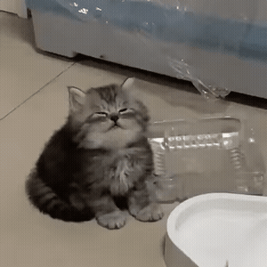

  

  
·:¨ﾟ+:ꔫ:* ⋅⋆∘¨ﾟ+:ꔫ: ⋅⋆¨ﾟ+:ꔫ:* ⋅⋆∘¨ﾟ+:ꔫ: ⋅⋆∘𓆩♡𓆪∘¨ﾟ+:ꔫ:* ⋅⋆∘¨ﾟ+:ꔫ: ⋅⋆⋆⋅*:ꔫ:+ﾟ¨¨ﾟ+:ꔫ:* ⋅⋆∘*: ·.

  <h3>𝐻𝑖。𝐼'𝑚 18 𝑦. 𝑜. 𝑟𝑢𝑠𝑠𝑖𝑎𝑛 𝑃𝑦𝑡ℎ𝑜𝑛/𝐶++ 𝑑𝑒𝑣𝑒𝑙𝑜𝑝𝑒𝑟 𝑎𝑛𝑑 𝑖𝑛𝑣𝑜𝑙𝑣𝑒𝑑 𝑖𝑛 𝑚𝑎𝑐ℎ𝑖𝑛𝑒 𝑙𝑒𝑎𝑟𝑛𝑖𝑛𝑔。</h3>
  
*·´∘⋆⋅*:☆ :*+ ¨*･･*¨ +* :☆:* ⋅⋆∘`·♱·´∘⋆⋅*:☆ :*+ ¨*･·´∘⋆⋅*:☆ :*+ ¨*･*

### 𝐴𝑏𝑜𝑢𝑡 𝑚𝑒:

𝑅𝑖𝑔ℎ𝑡 𝑛𝑜𝑤, 𝐼'𝑚 𝑏𝑢𝑖𝑙𝑑𝑖𝑛𝑔 𝑎 𝑠𝑜𝑙𝑖𝑑 𝑓𝑜𝑢𝑛𝑑𝑎𝑡𝑖𝑜𝑛 𝑖𝑛 𝑝𝑟𝑜𝑔𝑟𝑎𝑚𝑚𝑖𝑛𝑔. 𝐼'𝑚 𝑠𝑜𝑙𝑣𝑖𝑛𝑔 𝑝𝑟𝑜𝑏𝑙𝑒𝑚𝑠, 𝑤𝑟𝑖𝑡𝑖𝑛𝑔 𝑠𝑚𝑎𝑙𝑙 𝑢𝑡𝑖𝑙𝑖𝑡𝑖𝑒𝑠, 𝑎𝑛𝑑 𝑑𝑜𝑐𝑢𝑚𝑒𝑛𝑡𝑖𝑛𝑔 𝑚𝑦 𝑝𝑟𝑜𝑔𝑟𝑒𝑠𝑠 ℎ𝑒𝑟𝑒 𝑜𝑛 𝐺𝑖𝑡𝐻𝑢𝑏.

- 𝑙𝑒𝑎𝑟𝑛𝑖𝑛𝑔: 𝑃𝑦𝑡ℎ𝑜𝑛, 𝑎𝑙𝑔𝑜𝑟𝑖𝑡ℎ𝑚𝑠, 𝑎𝑛𝑑 ℎ𝑜𝑤 𝑡𝑜 𝑢𝑠𝑒 𝐺𝑖𝑡
- 𝑐𝑟𝑒𝑎𝑡𝑒 𝑝𝑒𝑡-𝑝𝑟𝑜𝑗𝑒𝑐𝑡𝑠

 

### 𝑀𝑦 𝑠𝑡𝑎𝑐𝑘:

  
  

### 𝐶𝑜𝑛𝑡𝑎𝑐𝑡𝑠:

𝐸𝑚𝑎𝑖𝑙 - 𝑥𝑖𝑠𝑙𝑜𝑟𝑛@𝑔𝑚𝑎𝑖𝑙.𝑐𝑜𝑚

